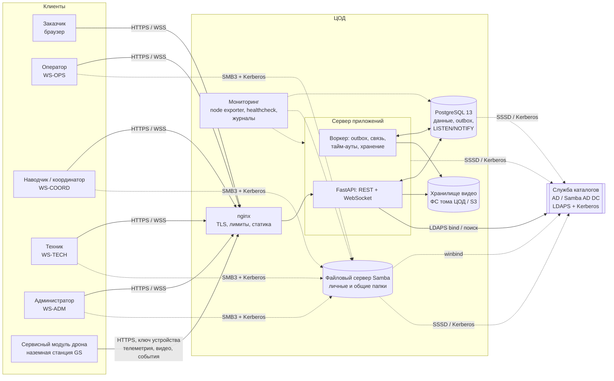
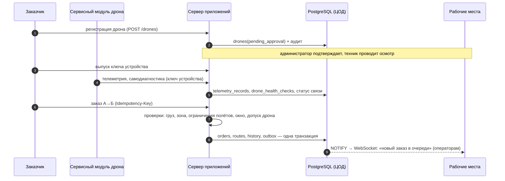
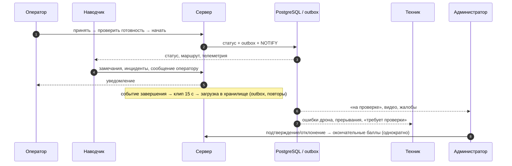

# Архитектура платформы

## 1. Обзор

Централизованная клиент-серверная система. В центре — ЦОД: сервер приложений, PostgreSQL,
хранилище видео, мониторинг и сервис обмена сообщениями. Рабочие места и сервисные модули
дронов подключаются к ЦОД по HTTPS/WSS.

## 2. Модули backend и сервисы ТЗ

Backend — модульный монолит на FastAPI (Python 3.9, совместим с Debian 11). Сервисы ТЗ
реализованы как отдельные модули с явными границами; их можно вынести в отдельные процессы
без изменения API, когда это потребуется по нагрузке.

| Сервис (ТЗ, разд. 12) | Модуль | API |
|---|---|---|
| Authentication Service | `services/identity.py`, `services/directory.py` | `/api/v1/auth/*` |
| User and Role Service | `services/identity.py`, `services/admin.py` | `/api/v1/admin/users`, `/roles`, `/domain-groups` |
| Order Management Service | `services/orders.py` (конечный автомат) | `/api/v1/orders/*` |
| Drone Registry Service | `services/drones.py` | `/api/v1/drones/*` |
| Telemetry Ingestion Service | `services/telemetry.py` | `/drone-link/v1/*` (отдельный контур) |
| Video Evidence Service | `services/video.py`, `services/storage.py` | `/drone-link/v1/video/segments`, `/api/v1/videos/*` |
| Scoring Service | `services/scoring.py`, `services/complaints.py` | `/api/v1/orders/{id}/score`, `/scores/me`, `/admin/complaints` |
| Notification Service | `services/notifications.py` | `/api/v1/me/notifications`, WebSocket |
| Audit Service | `services/audit.py` | `/api/v1/admin/audit`, `/audit/verify` |
| Administration Service | `services/admin.py` | `/api/v1/admin/*` |

Сквозные механизмы: `services/events.py` (outbox и LISTEN/NOTIFY), `api/deps.py`
(сессии, CSRF, лимиты, идемпотентность), `api/realtime.py` (WebSocket).

## 3. Потоки данных

### 3.1. Первичный обмен: дрон и заказчик → сервер → ЦОД → рабочие места

### 3.2. Вторичный обмен: сервер → оператор и наводчик; ЦОД → техник и администратор

### 3.3. Восстановление связи без дубликатов

* Сервер — единственный источник истины. WebSocket передаёт только сигналы (идентификаторы);
  клиент перечитывает состояние через REST. После переподключения клиент получает `resync`.
* Критические POST-операции принимают `Idempotency-Key`: повтор после обрыва возвращает
  сохранённый ответ (заголовок `Idempotent-Replay: true`) и не создаёт второй заказ.
* Переходы статусов выполняются под `SELECT … FOR UPDATE`; поддерживается `expected_version`
  (оптимистическая блокировка, 409 `version_conflict`).
* Сервисный модуль дрона нумерует записи телеметрии (`seq`, сохраняется на диске), при
  отсутствии связи копит их локально и досылает; сервер отбрасывает повторы по `(drone_id, seq)`.

## 4. Разделение информационного обмена и управления полётом

* Пользовательский API (`/api/v1`) — сессия доменного пользователя + CSRF + права из таблицы прав.
* Контур устройства (`/drone-link/v1`) — только ключ устройства (`Authorization: Drone …`),
  отдельные лимиты, приём телеметрии/видео/событий и выдача **справочной** информации о задании.
* Команд управления полётом нет ни в одном API. Интерфейс адаптера оборудования
  (`drone-agent/fpv_agent/adapters/base.py`) не содержит методов управления (проверяется тестом).
  Аварийные действия в воздухе — зона ответственности бортовой системы дрона; платформа при
  потере связи или критической ошибке прерывает задание и снимает дрон с эксплуатации до проверки.

## 5. Обоснование выбора компонентов

| Компонент | Выбор | Обоснование |
|---|---|---|
| ОС | Debian 11 | обязательное требование ТЗ (см. `debian11-lifecycle.md` — риски) |
| СУБД | PostgreSQL 13 (пакет Debian 11) | обязательное требование; триггеры неизменяемости, advisory-блокировки, `SKIP LOCKED`, `LISTEN/NOTIFY` |
| Backend | Python 3.9 + FastAPI | Python 3.9 — системный в Debian 11; FastAPI 0.115 поддерживает 3.9 |
| Очередь сообщений | транзакционный outbox в PostgreSQL | отдельный брокер (RabbitMQ/Kafka) не нужен для первой версии: объём событий мал, PostgreSQL уже обязателен, атомарность «изменение + событие» без двухфазной фиксации |
| Реальное время | WebSocket + `LISTEN/NOTIFY` | работает с несколькими процессами без Redis; NOTIFY доставляется только после COMMIT |
| Кэш | не используется | Redis не нужен в v1 (ТЗ: «при необходимости») |
| Хранилище видео | каталог на томе ЦОД или S3-совместимое (MinIO) | ФС — минимальная инфраструктура; S3 с Object Lock — для WORM-хранения; интерфейс единый |
| Frontend | React 18 + TypeScript + Vite | требование ТЗ; карта — встроенная SVG-схема (работает без внешних картографических сервисов в изолированной сети) |
| Развёртывание | Ansible + systemd, без Docker в production | Docker на Debian 11 возможен, но не нужен: службы изолируются средствами systemd; Docker используется только в тестах |
| Домен | Active Directory / Samba AD DC, LDAPS, Kerberos | Linux-интеграция через realmd/SSSD, файловые серверы — Samba winbind |

## 6. Масштабирование и отказоустойчивость

* API без состояния (сессии в БД) — горизонтально за nginx; `serial: 50%` в плейбуке для обновления без полного простоя.
* Воркеры — несколько экземпляров (`SKIP LOCKED`, advisory-блокировки плановых задач).
* Кольцевой буфер видео — на диске узла, принимающего поток; при нескольких узлах — привязка
  дрона к узлу на балансировщике (sticky по ключу устройства) или общий том spool.
* PostgreSQL — резервные копии с проверкой восстановления (ежедневно); потоковая реплика —
  следующий этап (не реализовано в v1).
* Ограничение частоты запросов — в процессе и на nginx (`limit_req`).
