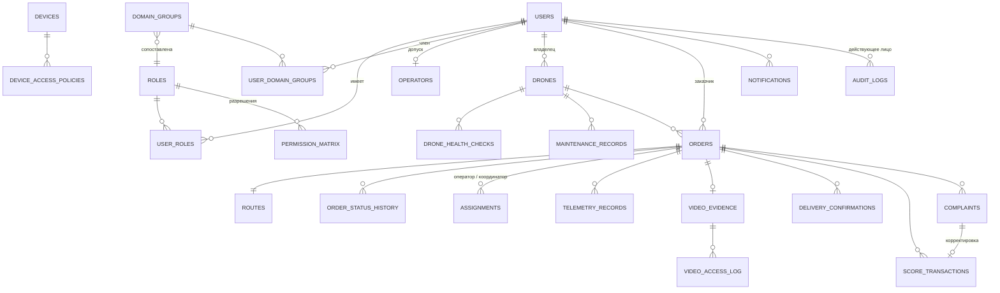

# Модель данных

Схема — SQL-миграции `database/migrations/` (PostgreSQL 13–17; целевая версия — 17), применяются `python -m fpv.migrate`
с контролем контрольных сумм (изменённая применённая миграция блокирует запуск).

## Основные связи

## Сущности ТЗ (разд. 13)

| Сущность ТЗ | Таблица | Ключевые ограничения |
|---|---|---|
| Users | `users` | `domain_object_id` UNIQUE (objectGUID); пароль домена не хранится (хеш пароля — только у учётных записей приложения); никнейм, местоположение; физическое удаление запрещено триггером |
| Roles / UserRoles | `roles`, `user_roles` | источник роли: `domain` (из группы) или `manual` |
| DomainGroups / UserDomainGroups | `domain_groups`, `user_domain_groups` | DN UNIQUE, сопоставление с ролью |
| Devices / DeviceAccessPolicies | `devices`, `device_access_policies` | правило либо по роли, либо по группе (CHECK), уникальность на устройство |
| PermissionMatrix | `permissions`, `permission_matrix` | каталог разрешений + матрица роль→разрешение |
| Drones | `drones` | статус регистрации, техсостояние, связь; ключ устройства — только SHA-256; тип БПЛА (`drone_model_id`), тип связи, конструкция, двигатель; архив (`archived_at`, причина из 9 значений) |
| Справочники | `cargo_types`, `drone_models` | код типа груза UNIQUE, название уникально среди неудалённых; тип БПЛА уникален по (производитель, модель) |
| DroneHealthChecks | `drone_health_checks` | источник: устройство / техник / система |
| Orders | `orders` | CHECK на 14 статусов, `version`, окно `window_end > window_start`, частичный UNIQUE «один активный заказ на дрон» |
| OrderStatusHistory | `order_status_history` | только добавление (триггер) |
| Грузы заказа | `order_cargo_items` | UNIQUE `(order_id, position)`; сводка в `orders.cargo_*` (масса — сумма, габариты — наибольшие) |
| Routes | `routes` | 1:1 с заказом, контрольные точки, результат проверки маршрута |
| Operators | `operators` | статус допуска, сумма баллов |
| Assignments | `assignments` | частичный UNIQUE: одно активное назначение роли на заказ |
| TelemetryRecords | `telemetry_records` | UNIQUE `(drone_id, seq)` — защита от дублей при досылке |
| VideoEvidence | `video_evidence` | UNIQUE на заказ; CHECK: `stored` ⇒ ключ и хеш; `missing` ⇒ причина; триггер запрещает удаление и подмену |
| DeliveryConfirmations | `delivery_confirmations` | UNIQUE `(order_id, kind)` |
| ScoreTransactions | `score_transactions` | частичный UNIQUE «одно окончательное начисление на заказ», корректировка требует причины, только добавление |
| Complaints | `complaints` | один открытый спор/апелляция на заказ |
| MaintenanceRecords | `maintenance_records` | |
| Notifications | `notifications` | `dedup_key` — повторная обработка события не дублирует уведомление |
| AuditLogs | `audit_logs` | только добавление (триггеры UPDATE/DELETE/TRUNCATE), хеш-цепочка `prev_hash → hash` |

Служебные таблицы: `sessions` (хеши токенов), `order_notes`, `video_access_log` (только добавление),
`scoring_rules` (версионирование, одна активная), `outbox_events`, `processed_events`,
`idempotency_keys`, `schema_migrations`.

## Индексы

Статусы и списки (`orders_status_idx`, `orders_customer_idx`, частичные по оператору и
координатору), телеметрия по заказу/дрону и времени, аудит по объекту/действию/автору,
outbox по `next_attempt_at` для невыполненных событий, уведомления по пользователю.

## Правила удаления данных

| Данные | Правило |
|---|---|
| Пользователь | только `status = 'deleted'` + обезличивание (имя, телефон, e-mail); заказы, баллы, аудит сохраняются (FK `ON DELETE RESTRICT`) |
| Заказы, история, баллы, аудит, журнал просмотров видео | не удаляются; изменение журналов запрещено триггерами |
| Видео | объект удаляется по истечении `retention_until` (по умолчанию 180 дн.), запись остаётся со статусом `purged` |
| Телеметрия | удаляется по истечении `FPV_TELEMETRY_RETENTION_DAYS` (по умолчанию 365) |
| Сессии | отзываются (`revoked_at`), не удаляются |
| Справочники (роли, группы) | `ON DELETE CASCADE` только для производных записей сопоставления |
