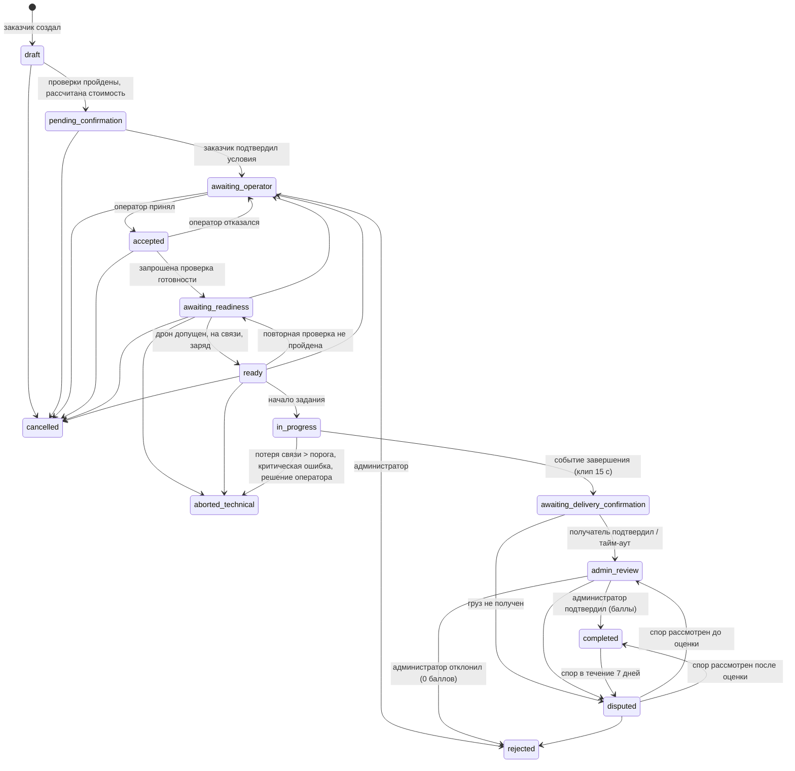

# Жизненный цикл заказа, видеоподтверждение и баллы

## Конечный автомат

Все переходы — `services/orders.py::TRANSITIONS`; любой другой переход отклоняется (409
`invalid_transition`). Каждое изменение: блокировка строки, `version + 1`, запись в
`order_status_history` (неизменяемая), аудит, событие outbox и сигнал реального времени.

| Статус ТЗ | Код |
|---|---|
| Черновик | `draft` |
| Ожидает подтверждения | `pending_confirmation` |
| Ожидает назначения оператора | `awaiting_operator` |
| Принят оператором | `accepted` |
| Ожидает проверки готовности | `awaiting_readiness` |
| Готов к выполнению | `ready` |
| Выполняется | `in_progress` |
| Ожидает подтверждения доставки | `awaiting_delivery_confirmation` |
| На проверке администратора | `admin_review` |
| Выполнен | `completed` |
| Отклонён | `rejected` |
| Отменён | `cancelled` |
| Прерван по техническим причинам | `aborted_technical` |
| Передан на рассмотрение спора | `disputed` |

## Проверки до подтверждения заказа

Тип груза из разрешённого списка; отсутствие признаков запрещённых категорий; масса и габариты;
точки А и Б в зоне обслуживания; расстояние; пересечение зон ограничения полётов (отрезок А–Б
против окружностей зон, `FPV_NO_FLY_ZONES`); временное окно в будущем и не короче 15 мин;
допуск дрона (регистрация, техсостояние «Исправен», свежая успешная диагностика,
грузоподъёмность, дальность с запасом на возврат); дрон не занят другим заказом.
Результат каждой проверки сохраняется в `orders.validation_result` и показывается заказчику.

Проверка готовности перед стартом дополнительно требует связи с сервисным модулем
(`online`) и заряда не ниже `FPV_MIN_BATTERY_PCT`; повторяется в момент старта.

## Защита от повторов

* повторное выполнение: старт только из `ready`; повторное событие завершения (оператор и дрон
  одновременно) не меняет заказ;
* повторное начисление: `score_transactions_final_uq` + проверка в `scoring.finalize`;
* повторная корректировка по одной жалобе: `score_transactions_complaint_uq`;
* повтор запроса клиентом: `Idempotency-Key`.

## Видеоподтверждение (последние 15 секунд)

1. После старта сервисный модуль передаёт сегменты MPEG-TS (~1 с) в `/drone-link/v1/video/segments`.
2. Сервер хранит их в кольцевом буфере (`FPV_VIDEO_SPOOL_DIR/<order>/ring`), вытесняя всё старше
   15 с + 5 с запаса. Время сегментов — серверное время получения (не зависит от часов дрона).
3. Событие завершения (оператор или `delivery_completed` от дрона), а также прерывание задания
   вырезают клип: сегменты, пересекающиеся с [событие − 15 с, событие]. Клип склеивается,
   SHA-256 вычисляется в момент захвата; запись `video_evidence` привязана к заказу.
4. Загрузка в хранилище — асинхронно через outbox с повторами; после загрузки хеш сверяется,
   при наличии ffmpeg создаётся MP4-копия для просмотра в браузере (оригинал — доказательство).
5. Нет потока — `status = missing` с причиной, фиктивная запись не создаётся.
6. Просмотр — только с разрешением `video.read`; каждый просмотр/скачивание/проверка целостности
   фиксируются в `video_access_log` и аудите. Подмена файла обнаруживается проверкой целостности
   (`POST /admin/videos/{id}/verify`, `python -m fpv.cli verify-videos`).

Точность границы клипа — длительность сегмента (1 с).

## Баллы

| Компонент | Макс. | Условие |
|---|---|---|
| Временное окно | 30 | в окне — 30; вне окна линейно до 0 при отклонении `grace_minutes` (30 мин); скорость не учитывается |
| Подтверждение получения | 20 | получатель подтвердил |
| Отчёт | 10 | оператор сформировал отчёт |
| Видео | 20 | клип сохранён и подтверждён администратором |
| Подтверждение администратора | 20 | решение «подтвердить» |
| Обоснованная претензия | −20 | за каждую удовлетворённую претензию (в пределах части «результат») |

До проверки показывается предварительный результат, после решения администратора —
окончательный (в транзакции хранится разбивка и версия правил). Апелляция и спор после оценки
приводят к корректировке с обязательной причиной и записью в аудит; итог по заказу ограничен 0–100.
Правила редактируются администратором и версионируются (`scoring_rules`), сумма максимумов = 100.
